<div align="center">


# CCUsageX — Claude Code usage dashboard

**See every prompt, token and dollar of your Claude Code usage.**
A local, zero-dependency web dashboard that reads Claude Code's own logs and shows requests, models, tokens,
cache hits, response times, tools, sessions and the API-equivalent cost of each prompt you type.

[](https://mhjoy99.github.io/CCUsageX/demo/)
[](LICENSE)


[**Live demo**](https://mhjoy99.github.io/CCUsageX/demo/) ·
[**Website**](https://mhjoy99.github.io/CCUsageX/) ·
[Quick start](#quick-start) ·
[How it works](#how-it-works) ·
[FAQ](#faq) ·
[Docs](docs/ARCHITECTURE.md)

</div>

---

## What is CCUsageX?

**CCUsageX is a free, open-source dashboard for [Claude Code](https://docs.claude.com/en/docs/claude-code) usage that runs
entirely on your computer.** It reads the transcript files Claude Code already writes to `~/.claude/projects`, works out
exactly which API requests each of your prompts triggered (including subagents), and shows the tokens, cache savings,
response time and **API-equivalent cost** of every one, in a fast web UI at `http://127.0.0.1:3020`.
Nothing is uploaded anywhere, and it needs nothing but Node.js 18+.


## Features

<table>
<tr>
<td width="50%"></td>
<td width="50%"></td>
</tr>
<tr>
<td width="50%"></td>
<td width="50%"></td>
</tr>
</table>

- **Every prompt, priced.** Click any prompt to read it in full and see each API request it caused, including
  subagents, with tokens and cost per request.
- **Real token accounting.** Input, output, cache write (5-minute and 1-hour), cache read and thinking tokens,
  deduplicated exactly the way Claude Code writes them (one line per content block, one request each).
- **API-equivalent cost.** Priced at Anthropic list prices from an editable [`config.json`](config.json), including the
  cache-write multipliers, Haiku long-context tier and fast mode. Useful on a Pro/Max subscription to see what your
  usage is worth.
- **Cache savings.** Cache hit rate and the dollars caching saved you.
- **Plan usage limits.** Your 5-hour session and 7-day weekly limits on Pro and Max, with reset times, a pace
  projection and a small history, plus per-model weekly limits when Claude Code reports them. Read from Claude Code's own
  `/usage` report and refreshed automatically; see [Plan usage limits](#plan-usage-limits).
- **Desktop widget.** A small always-visible Claude Pulse widget (Rainmeter on Windows, or any browser) with your limits,
  burn pace and measured heavy hours; see [Desktop widget](#desktop-widget-windows-rainmeter).
- **Models, effort, speed.** Output tokens per second, response time (typical and slowest 5%), effort levels and
  Claude Code versions.
- **Tools, sessions, projects.** Which tools ran how often, per-session and per-project breakdowns.
- **Live view, in real time.** A mission-control tab that streams what Claude Code is doing as it happens:
  current status with a ticking timer, the main agent and its subagents, tool calls as live swimlanes, a
  scrolling activity chart, context-window gauge, rolling cost and token counters, and an event feed.
  Events reach the browser a few milliseconds after Claude Code writes them (file watcher + Server-Sent Events).
- **Keeps your history.** Claude Code deletes old transcripts after 30 days by default; CCUsageX keeps its own copy.
- **Filters and export.** Time range, model, project, session, main vs subagent, full-text search, CSV export.
- **Honest numbers.** Independently verified against a separate re-implementation and against ccusage token counts;
  known gaps in Claude Code's logs are labelled in the UI ([details](docs/FAQ.md)).

## Quick start


You need **Node.js 18 or newer**. No `npm install` step: there are no dependencies.

```bash
git clone https://github.com/MHJoy99/CCUsageX.git
cd CCUsageX
node server.js
```

Open **http://127.0.0.1:3020**. Or run it straight from GitHub without cloning:

```bash
npx github:MHJoy99/CCUsageX
```

Want to look around first? Try the [**live demo**](https://mhjoy99.github.io/CCUsageX/demo/) (fictional data), or run
the demo locally with `npm run demo`.

### Windows: open it like a desktop app

Double-click **`Open-CCUsageX.cmd`**. It starts the server hidden and opens the dashboard in Google Chrome (Edge app window if Chrome is missing).
`Close-CCUsageX.cmd` stops the server. For a Start Menu entry and more, see
[`CCUsageX.ps1`](CCUsageX.ps1) (`-Action start|stop|status|restart`).

### macOS / Linux

`node server.js`, then open http://127.0.0.1:3020. To keep it running in the background, use your usual tool
(`launchd`, `systemd --user`, `pm2`, `tmux`).

## Plan usage limits


CCUsageX shows how much of your Claude subscription limit you have used: the **5-hour session** window and the
**7-day weekly** window, with when each one resets, plus the **per-model weekly limits** (for example one for a single
model) when Claude Code reports them. The numbers refresh automatically from Claude Code's documented `/usage` report,
every 2 minutes while you look at the dashboard (every 15 minutes otherwise). This works the same in the terminal and in
the VS Code panel. It uses no model tokens and writes no transcript: CCUsageX runs the local command
`claude -p` with the single prompt `/usage` (the Agent SDK documents `usage_report.rate_limits` for it). It takes about
3 seconds and costs nothing. The refresh button on the card runs it on demand.

The probe finds `claude` on your `PATH`, or the binary bundled with the VS Code, Cursor or Windsurf extension. Set
`CCU_CLAUDE_BIN` to point at a specific binary, or `CCU_LIMITS_PROBE=0` to turn the probe off.

The status line is now **optional**. It gives instant updates in terminal `claude` sessions (on every reply), and
CCUsageX uses whichever source changed most recently. Set it up from the repository folder:

```bash
npm run statusline:install        # or: node scripts/install-statusline.js --install
node scripts/install-statusline.js --status
npm run statusline:uninstall      # restores the status line you had before
```

The installer edits only the `statusLine` entry of your Claude Code `settings.json` (`~/.claude/settings.json`, or
`$CLAUDE_CONFIG_DIR/settings.json`):

- It copies the file to `settings.json.bak-<YYYYMMDD-HHMMSS>` first, and leaves every other setting as it was.
- If you already have a status line, it keeps running. CCUsageX runs it and shows its output, and saves your previous
  setting under `ccusagexPreviousStatusLine`, so `--uninstall` puts it back exactly.
- An invalid `settings.json` stops the installer before anything is written.
- `--dry-run` shows the change without writing, and `--config-dir <dir>` picks another Claude Code folder.

Things to know:

- **Pro and Max only.** Claude Code reports these limits for claude.ai subscriptions. With an API key, a third-party
  provider, or a login without profile access, the report has no limits and the card says so.
- **The status line is optional.** In our tests only terminal `claude` sessions ran it, and the VS Code panel did not;
  the `/usage` probe does not depend on it.
- **Local data only.** Snapshots are written to `~/.ccusagex/limits/` (or `$CCU_DATA_DIR/limits/`). CCUsageX makes no
  network request itself; it only runs the local `claude` command above and never reads your credentials.

Details, including the data fields and the burn-rate projection, are in
[docs/ARCHITECTURE.md](docs/ARCHITECTURE.md#plan-usage-limits).

## Desktop widget (Windows, Rainmeter)

**Claude Pulse** is a small desktop widget that keeps your limits in sight while you work. It shows:

- a **peak clock** with **your heavy hours** (measured from your own history) and the informational **US busy hours**,
- the **5-hour** and **weekly** rings with reset times, and **per-model** weekly limits,
- your **burn pace**, a **settings gear**, a **compact mode**, and a clear **offline** state when CCUsageX is not running,
- the **plan value**: what your plan gives in API-equivalent dollars (measured, never typed in) against what you spent
  today and yesterday, and, with several saved accounts, each account's weekly % and the work left across all of them,
- a plain **will it last?** answer for all accounts together ("safe up to $X/day"), and effort/model tips from your own logs.

Install it on Windows with [Rainmeter](https://www.rainmeter.net) (CCUsageX must be running):

```powershell
powershell -ExecutionPolicy Bypass -File scripts\install-widget.ps1
```

The installer runs in Windows PowerShell 5.1 (built into Windows) and in PowerShell 7.

Remove it with `scripts\install-widget.ps1 -Uninstall` (add `-RemovePlugin` to delete the plugin too). Add
`-StartWithWindows` to launch Rainmeter at logon, or `-WhatIf` to preview. The installer needs no admin rights and
never installs Rainmeter itself.

**Any OS, no Rainmeter:** open **http://127.0.0.1:3020/widget.html** in a browser; it is the same widget.

**Privacy.** Local only. The widget talks to `127.0.0.1` and nothing else. The only network access is the one-time
download of the [WebView2 plugin](https://github.com/NSTechBytes/WebView2) from its official GitHub release, checked
against a pinned SHA256.

**An honest note on the two bands.** Anthropic said on 2026-03-26 that 5-hour limits drain faster on weekdays 5-11am
Pacific ([Business Insider](https://www.businessinsider.com/claude-usage-caps-changes-popularity-anthropic-2026-3)),
then [removed that reduction for Pro and Max on 2026-05-06](https://www.anthropic.com/news/higher-limits-spacex).
So the US band is **informational** and labelled that way. The **heavy-hours band is measured from your own
history** (limit percentage used per dollar of work, by hour of day) and needs at least 3 days of data. Details,
configuration and troubleshooting: [docs/WIDGET.md](docs/WIDGET.md).
## Screenshots

<div align="center">
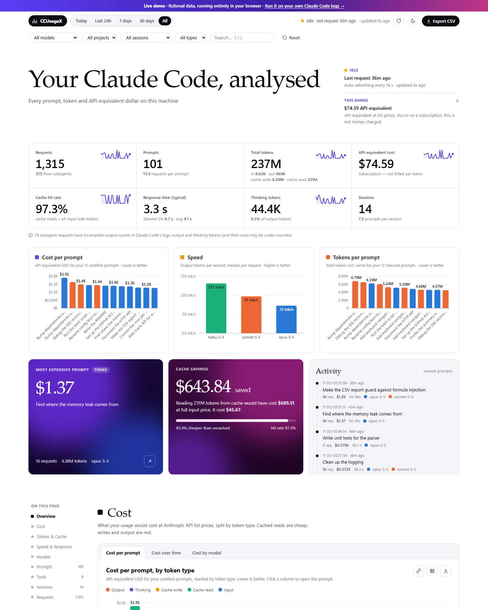
<br><br>
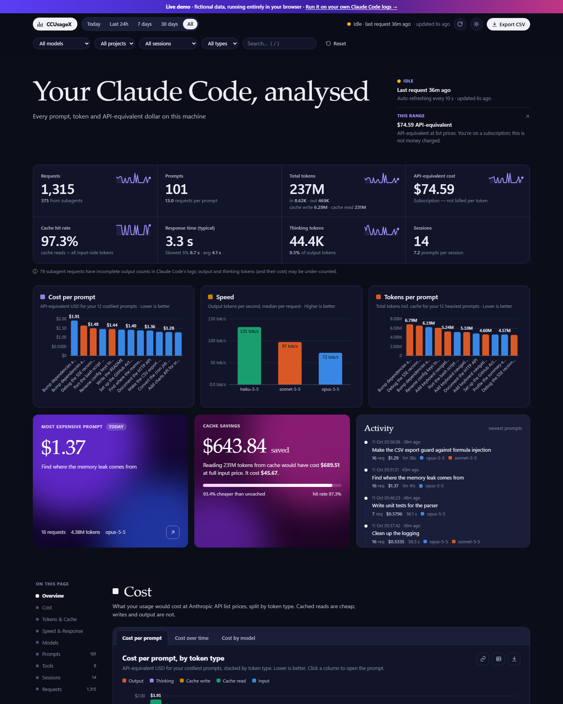
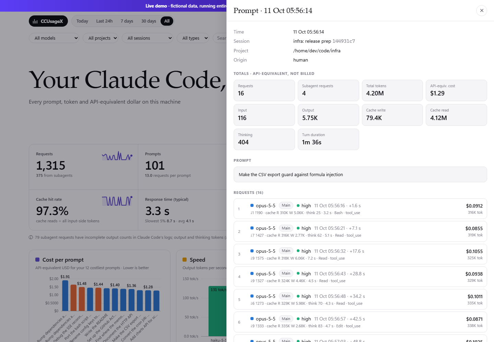
<br><br>
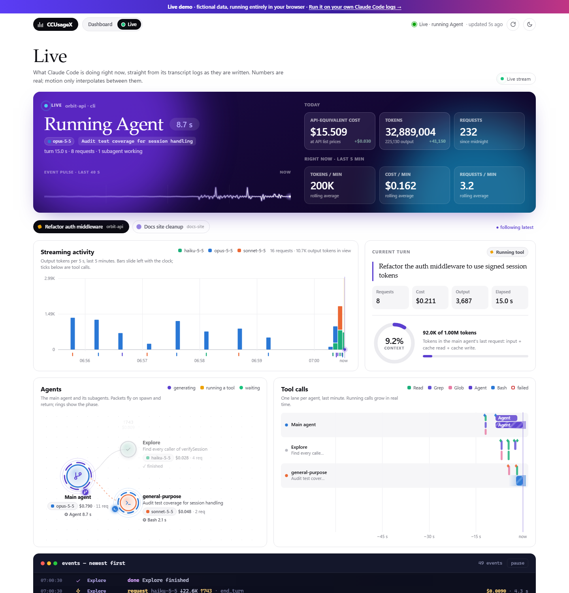
<br><sub>All screenshots use fictional demo data. Try the Live tab in the <a href="https://mhjoy99.github.io/CCUsageX/demo/#view=live">live demo</a>.</sub>
</div>

## How it works


1. Claude Code (CLI or IDE extension) writes every conversation to `~/.claude/projects/**/*.jsonl`.
2. CCUsageX reads those files **read-only**, incrementally, every few seconds.
3. Each API response is counted once (by message id + request id) and attributed to the human prompt that caused it.
   Subagent work rolls up to the parent prompt.
4. Requests are priced with [`config.json`](config.json) and kept in `~/.ccusagex/store.json`.
5. A small built-in HTTP server serves the dashboard and a JSON API on `127.0.0.1` only.

Full details, including the record format, dedupe rules and the HTTP API, are in
[docs/ARCHITECTURE.md](docs/ARCHITECTURE.md).

## How it compares

| | **CCUsageX** | [ccusage](https://github.com/ryoppippi/ccusage) | [Claude-Code-Usage-Monitor](https://github.com/Maciek-roboblog/Claude-Code-Usage-Monitor) | [Sniffly](https://github.com/chiphuyen/sniffly) |
|---|---|---|---|---|
| Interface | Local web dashboard | CLI tables / JSON | Live terminal UI | Local web dashboard |
| Cost per **prompt**, with the prompt text | ✅ | — | — | Partial |
| Subagent requests attributed to the parent prompt | ✅ | — | — | — |
| Cache hit rate and cache savings | ✅ | Tokens only | — | — |
| Response time and output speed by model | ✅ | — | Burn rate | — |
| Keeps history after Claude Code's 30-day cleanup | ✅ | — | — | — |
| Other coding agents (Codex, OpenCode, …) | — | ✅ | — | — |
| Live plan-limit / quota tracking | ✅ | Partial | ✅ | — |
| Dependencies | None | npm package | Python package | Python package |

These tools work well together. ccusage is excellent for quick terminal reports across many agents, and the
Usage Monitor is great for watching plan limits live.

## Configuration

Everything is in [`config.json`](config.json):

| Key | Default | Meaning |
|---|---|---|
| `startDate` | `"all"` | Only count usage on/after this local date (`"YYYY-MM-DD"`), or `"all"` |
| `port` | `3020` | Dashboard port (bound to `127.0.0.1`) |
| `scanIntervalSeconds` | `5` | How often transcripts are re-scanned |
| `pricing.models` | Anthropic list prices | USD per million tokens: `input`, `output`, `cacheRead`, optional `fastMultiplier`, `longContext` |

Environment variables: `PORT`, `CLAUDE_CONFIG_DIR` (where Claude Code keeps its data, default `~/.claude`),
`CCU_DATA_DIR` (where CCUsageX keeps its store, default `~/.ccusagex`), `CCU_START_DATE`.

## Privacy

- Runs only on your machine and listens on `127.0.0.1` only (requests with a foreign `Host` header are rejected).
- Makes **no outbound network requests** of its own, has no telemetry and no dependencies.
- Reads `~/.claude` **read-only**. Its own copy, which includes your prompt text, is stored in `~/.ccusagex/`.
  Delete that folder to remove it.
- Plan limits come from running Claude Code's own `/usage` command locally (no model call, no tokens, no network request
  from CCUsageX). Snapshots go under `~/.ccusagex/limits/`. The optional status line edits only the `statusLine` entry in
  Claude Code's `settings.json`, after making a backup.

## FAQ

**How do I see my Claude Code token usage?**
Run `node server.js` in this repo and open http://127.0.0.1:3020. CCUsageX reads Claude Code's logs and shows tokens
per prompt, request, model, session and day.

**How much does my Claude Code usage cost?**
CCUsageX prices every request at Anthropic's API list prices ("API-equivalent cost"). If you're on a Pro or Max
subscription, that's the value of your usage, not money you were charged.

**Where does Claude Code store its logs?**
In `~/.claude/projects/<project>/<session>.jsonl` (on Windows, `%USERPROFILE%\.claude\projects`). Subagent
transcripts sit in a `subagents` folder next to the session file.

**Does CCUsageX send my data anywhere?**
No. It has no network code beyond its own local server, which only listens on `127.0.0.1`.

**Why do some subagent requests show very few output tokens?**
For many subagent requests Claude Code only writes the usage from the start of the stream, so output and thinking
tokens are a lower bound. CCUsageX flags these requests and labels the affected totals instead of guessing.

**How is it different from ccusage?**
ccusage is a CLI that reports usage across many coding agents. CCUsageX is a web dashboard focused on Claude Code that
goes per prompt: prompt text, subagent attribution, cache savings, response times and persistent history.

More answers in [docs/FAQ.md](docs/FAQ.md).

## Development

```bash
npm test          # 38 unit tests on synthetic transcripts (node:test, no deps)
npm run verify    # independent re-count of your real logs vs. the running dashboard
npm run demo      # dashboard on generated demo data
```

See [CONTRIBUTING.md](CONTRIBUTING.md). Bugs and ideas are welcome in
[issues](https://github.com/MHJoy99/CCUsageX/issues).

## License

[MIT](LICENSE) © MHJoy99. CCUsageX is an independent project and is not affiliated with or endorsed by Anthropic.
"Claude" and "Claude Code" are trademarks of Anthropic.
